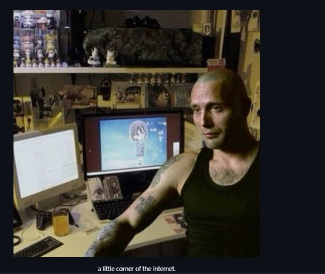
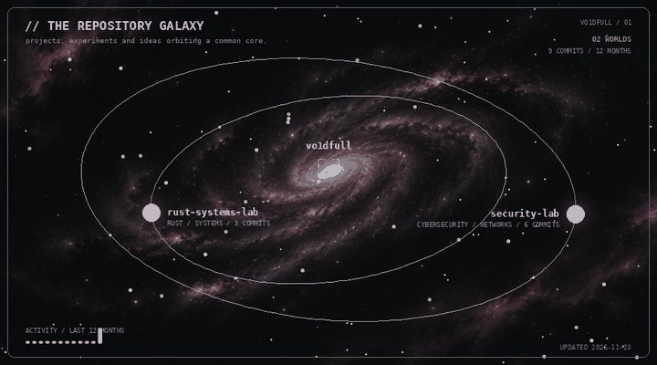

<div align="center">

# `vo1dfull`

**curiosity in ; systems out**

<br>

**Adarsh Chaudhary** · Computer Science undergraduate · Cybersecurity

`building things` · `understanding systems` · `breaking things in a lab`

[portfolio](https://adarshchaudhary.xyz) · [linkedin](https://www.linkedin.com/in/adarshchaudharycs) · [instagram](https://www.instagram.com/ad7rrsh)

</div>

---

```bash
adarsh@vo1dfull:~$ cat about.txt
```

I'm a Computer Science student interested in the layers beneath the interface: how software is built, how operating systems behave, how networks communicate, and how systems fail.

I spend my time learning, building projects, experimenting with Linux, and getting more comfortable with the fundamentals that make good engineering possible.

I don't have everything figured out. That's kind of the point.

<div align="center">
  
  <br>
  <sub>a little corner of the internet.</sub>
</div>

---

## `01 / current focus`

| Area | What I'm working on |
|:--|:--|
| `programming` | Strengthening C++ and problem-solving fundamentals |
| `rust` | Learning ownership, memory safety and systems programming |
| `systems` | Linux, operating systems and how software interacts with hardware |
| `networking` | Protocols, network fundamentals and troubleshooting |
| `cybersecurity` | Learning security concepts through labs and practical projects |

## `02 / selected work`

<table>
  <tr>
    <td width="50%" valign="top">
      <h3><a href="https://github.com/vo1dfull/rust-systems-lab">rust-systems-lab ↗</a></h3>
      <sub>RUST / SYSTEMS PROGRAMMING</sub>
      <p>Experiments in Rust, systems programming, memory safety and practical tooling.</p>
    </td>
    <td width="50%" valign="top">
      <h3><a href="https://github.com/vo1dfull/security-lab">security-lab ↗</a></h3>
      <sub>CYBERSECURITY / NETWORKING</sub>
      <p>Hands-on security experiments, network analysis, threat hunting and detection engineering.</p>
    </td>
  </tr>
</table>

## `03 / tech stack & tools`

**Languages**

<div>
  
</div>

**Environment & workflow**

<div>
  
</div>

<sub>This is a snapshot of tools I use or am actively learning — not a claim of mastery.</sub>

## `04 / repository galaxy`

<div align="center">
  
  <sub>projects, experiments and ideas orbiting a common core.</sub>
</div>

## `05 / outside the terminal`

Technology is the main rabbit hole, but not the only one. I'm into gaming, the wider gaming industry, music and guitar, and the occasional deep dive into how something works just because it caught my attention.

I like building things, but I also like understanding why they work.

## `06 / contact`

If you're building something interesting, working on open source, or want to talk tech, feel free to reach out.

- **Portfolio:** [adarshchaudhary.xyz](https://adarshchaudhary.xyz)
- **LinkedIn:** [adarshchaudhary67](https://www.linkedin.com/in/adarshchaudharycs)
- **Instagram:** [ad7rrsh](https://www.instagram.com/ad7rrsh)
- **Email:** [ad7rshchaudhary@gmail.com](mailto:ad7rshchaudhary@gmail.com)

---

<div align="center">

```text
[ process exited with code 0 ]

still learning. still building. see you in the logs.
```

<sub>Thanks for stopping by.</sub>

</div>
